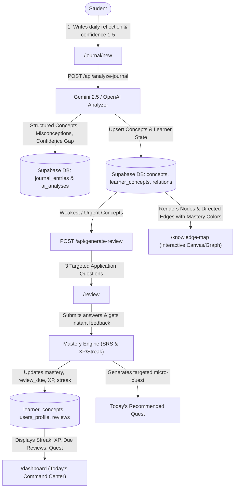
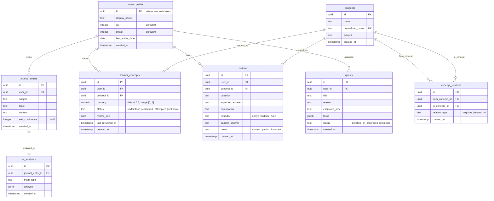

# Implementation Plan - Cati SRL: AI Self-Regulated Learning Companion

**Cati SRL** is an intelligent, self-regulated learning (SRL) companion built for the **Next Byte Hacks V5** hackathon. It empowers high school and university students to transform brief study reflections into structured knowledge graphs, calibrated metacognitive insights, adaptive spaced reviews, and targeted micro-quests.

---

## 1. System Architecture & High-Level Flow



---

## 2. Technical Stack & Dependencies

| Layer               | Technology                                         | Details                                                                                                 |
| :------------------ | :------------------------------------------------- | :------------------------------------------------------------------------------------------------------ |
| **Framework**       | Next.js 15+ (App Router)                           | React 19, TypeScript, Server & Client Components                                                        |
| **Styling**         | Tailwind CSS v3/v4                                 | Custom dark palette, Lucide icons, glassmorphism, micro-animations                                      |
| **Database & Auth** | Supabase (PostgreSQL)                              | Supabase Auth (email/password), Row Level Security (RLS), `@supabase/ssr`                               |
| **AI Integration**  | Google Gemini (`@google/genai`) / OpenAI           | Structured JSON schema validation with `zod`, plus graceful offline mock fallback for demo resilience   |
| **Knowledge Graph** | Custom Interactive SVG / Canvas or `@xyflow/react` | Force-directed or hierarchical node layout with zoom/pan, click-to-inspect drawer, mastery color coding |
| **Deployment**      | Vercel & GitHub                                    | Ready for 1-click cloud deployment with `.env.example`                                                  |

---

## 3. Database Schema & RLS Policies (`supabase/schema.sql`)

The database is built on PostgreSQL with strict Row Level Security (RLS) guaranteeing data privacy.



### Key RLS Policies:

- `users_profile`: `auth.uid() = id`
- `journal_entries`, `learner_concepts`, `reviews`, `quests`: `auth.uid() = user_id`
- `concepts`, `concept_relations`: Read access for all authenticated users; upsert permissions for authenticated users via server actions/API.
- Auto-profile trigger: PostgreSQL function on `auth.users` insert to initialize `users_profile` record with 0 XP, 0 streak, and display name.

---

## 4. Mastery Engine & Spaced Repetition (SRS) Formulas

Explicit, explainable learning mechanics:

1. **Answer Evaluation**:
   - `correct`: $+0.15$
   - `partial`: $+0.05$
   - `incorrect`: $-0.10$
2. **Lapse Decay**:
   - If `review_due` is overdue by $> 3$ days: $-0.05$
3. **Mastery Clamping**: $\text{mastery} = \max(0.0, \min(1.0, \text{new\_mastery}))$
4. **Adaptive Scheduling Intervals**:
   - $\text{mastery} < 0.4$ (Weak): next review due in **1 day**
   - $0.4 \le \text{mastery} \le 0.7$ (Developing): next review due in **3 days**
   - $\text{mastery} > 0.7$ (Strong): next review due in **7 days**
5. **XP & Gamification**:
   - $+50$ XP per journal entry analyzed
   - $+25$ XP per review question answered (+25 bonus on completion)
   - $+100$ XP on quest completion
   - Streak updates when at least 1 journal entry or 1 review is completed on the current calendar date.

---

## 5. AI Service & Metacognitive Analysis (`/lib/ai`)

Two specialized API endpoints with strict JSON schemas validated via **Zod**:

### 1. `POST /api/analyze-journal`

- **Metacognitive Calibration**: Compares the student's self-reported confidence ($1-5$) with the inferred conceptual clarity in the text:
  - _Overconfident_: Self-confidence is high ($4-5$), but explanation contains glaring misconceptions, circular logic, or weak reasoning.
  - _Underconfident_: Self-confidence is low ($1-2$), but student correctly articulates nuances and principles.
  - _Aligned_: Inferred clarity matches self-reported confidence within $\pm 1$.
- **Concept Extraction**: Identifies 2–5 distinct concepts and marks their status (`understood`, `confused`, `attempted`, `unknown`).
- **Misconception Detection**: pinpoints faulty assumptions and provides exact verbatim evidence from the journal.
- **Actionable Next Step**: Concrete, bite-sized recommendation (e.g., "Trace recursion depth with $n=3$ on paper before writing code").

### 2. `POST /api/generate-review`

- Extracts the student's weakest or most overdue concepts from `learner_concepts`.
- Generates **exactly 3 questions** of progressive difficulty:
  1. Foundational prerequisite check (easy/medium)
  2. Application & scenario question (medium/hard)
  3. Misconception disambiguation (medium/hard)
- Evaluates student answers with immediate explanation and rubric.

_(Resilience Guarantee: A deterministic local fallback engine runs automatically if external AI keys are absent or rate-limited, ensuring zero broken flows during judge testing)._

---

## 6. Page Structure & User Experience

```
src/
├── app/
│   ├── layout.tsx                # Root layout with Dark theme, fonts, nav header
│   ├── page.tsx                  # Landing / Product hero & instant demo entrance
│   ├── login/page.tsx            # Supabase Auth login/signup + "One-Click Demo Student" button
│   ├── dashboard/page.tsx        # "Today" dashboard: Streak, XP, Due count, Quest card, Recent topics
│   ├── journal/
│   │   └── new/page.tsx          # Journal editor: Subject, Topic, Rich reflection, Confidence slider
│   ├── insights/
│   │   └── [entryId]/page.tsx   # Detailed Metacognitive Insight report with visual radar & concept pills
│   ├── review/page.tsx           # Adaptive 3-question review session with instant feedback & mastery deltas
│   ├── knowledge-map/page.tsx    # Interactive Knowledge Graph with pan/zoom, mastery filters, & detail drawer
│   └── api/
│       ├── analyze-journal/route.ts
│       ├── generate-review/route.ts
│       ├── evaluate-review/route.ts
│       └── demo-seed/route.ts    # Instant reset / re-seed endpoint for Python Demo scenario
```

### UI & Aesthetic Highlights:

- **Calm, High-End Dark Palette**: Obsidian backgrounds (`#0B0F17`, `#111827`), translucent glass containers with subtle border gradients (`border-slate-800/80`), ambient glow accents (violet `#8B5CF6`, emerald `#10B981`, amber `#F59E0B`).
- **Cati Mascot**: Whimsical yet refined geometric feline icon with stateful expressions (thinking when analyzing, celebrating on streak, guiding on quests).
- **Knowledge Map**: Fully interactive network graph with glowing node halos colored by mastery (Red = Weak, Amber = Developing, Emerald = Strong), clickable for drawer inspection and "Practice Now" deep links.

---

## 7. Realistic Demo Dataset (Python Learner Scenario)

Pre-loaded demo scenario ready out-of-the-box:

- **Subject**: Computer Science / Python Programming
- **Concepts**:
  - `Recursion` (Mastery: 0.35 - Weak)
  - `Base case` (Mastery: 0.20 - Urgent, confused)
  - `Call stack` (Mastery: 0.45 - Developing)
  - `Functions` (Mastery: 0.85 - Mastered)
  - `Factorial` (Mastery: 0.50 - Developing)
  - `Loops` (Mastery: 0.90 - Mastered)
  - `Variables` (Mastery: 0.95 - Mastered)
- **Relationships**:
  - `Recursion` _requires_ `Base case`
  - `Recursion` _requires_ `Call stack`
  - `Recursion` _requires_ `Functions`
  - `Factorial` _related_to_ `Recursion`
  - `Call stack` _requires_ `Functions`
- **Initial Journal**:
  - _"Today I tried writing a recursive function for factorial in Python. It worked for 3! and 4!, but when I tried passing -1 it crashed with a Maximum Recursion Depth error. I don't really get why it kept calling itself forever without stopping."_
  - Self-confidence: 4 / 5
  - AI verdict: Overconfident; missing base case guard clause for negative integers; stack overflow hazard.
- **Active Quest**: _"Base Case Guardrail Mastery"_ (15 mins) with 3 actionable checklist items.

---

## 8. Verification & Demo Readiness Plan

### Automated Verification:

- Next.js build compilation (`npm run build`)
- TypeScript type checking (`tsc --noEmit`)
- API schema validation tests for journal analysis & review generation

### Manual End-to-End Walkthrough:

1. **Authentication / Demo Access**: Log in or click "Explore as Demo Student" to load pre-configured state.
2. **Today Dashboard**: Verify XP, streak, pending review banner, active quest card, and recent topic cards.
3. **New Journal Entry**: Write an entry with confidence slider, submit, and observe the AI analysis loading state.
4. **Insights View**: Verify the metacognitive gap (e.g. "Overconfident"), concepts discovered, and actionable advice.
5. **Knowledge Map**: Inspect updated nodes, verify red/amber/green color indicators, click to inspect relations.
6. **Adaptive Review**: Answer 3 targeted questions, check immediate grading, observe XP gain, and verify mastery score increases.
7. **Quest Progression**: Check off quest tasks and confirm dashboard reflects updated progress.

---

## 9. Deliverables List

1. Complete Next.js App Router project in `d:/CatiX/Next Byte Hacks V5`
2. `supabase/schema.sql` (Tables, constraints, RLS policies, triggers)
3. `supabase/seed.sql` (Python curriculum demo dataset)
4. AI prompt constants in `src/lib/ai/prompts.ts` with strict JSON schemas
5. Spaced repetition & mastery calculator in `src/lib/mastery.ts`
6. Interactive Knowledge Map component in `src/components/knowledge-map/`
7. Comprehensive `README.md` with:
   - System architecture Mermaid diagram
   - Local setup & environment instructions
   - "What Cati SRL Demonstrates" section
   - "Future Roadmap" section
